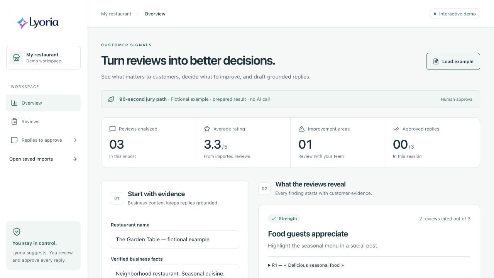
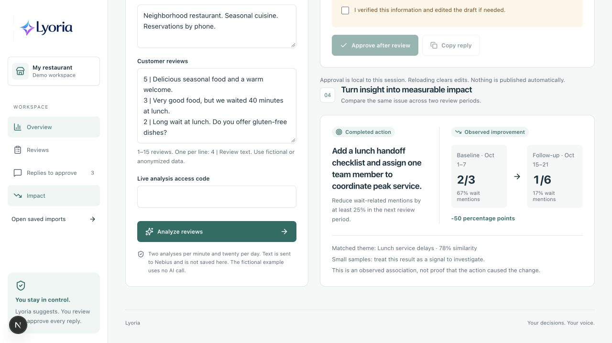
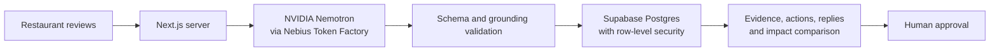

# Lyoria ReviewOps

**Turn customer reviews into evidence-linked actions and human-approved replies.**

Lyoria is a hackathon project for independent restaurants. It imports dated reviews, uses NVIDIA Nemotron through Nebius Token Factory to identify recurring themes, links every finding to exact evidence, suggests measurable actions and prepares replies that remain under human control.

**Live demo:** [lyoria.ch](https://lyoria.ch)



## Why Lyoria is different

- Every generated finding cites exact customer quotations.
- Priority is calculated from frequency, severity and recency with a visible formula.
- Recommendations become measurable actions tied to a tracked theme.
- Later review periods show observed improvement, stability or deterioration with sample sizes and uncertainty.
- Replies require review and approval; Lyoria never publishes automatically.

## NVIDIA and Nebius

Lyoria uses `nvidia/nemotron-3-super-120b-a12b` through the Nebius Token Factory chat-completions API. This balanced mixture-of-experts model handles the language-heavy work: grouping French or English reviews, drafting replies and identifying facts that need owner verification, at substantially lower token prices than Nemotron 3 Ultra.

Deterministic application code then rejects malformed output, missing replies, invented review quotations and unsupported business facts before anything is saved.

## Product flow

1. Import 1–15 dated reviews by paste or CSV.
2. Analyse them with NVIDIA Nemotron through Nebius.
3. Inspect themes, exact evidence, confidence and priority.
4. Turn an issue into a measurable action.
5. Edit and approve grounded replies.
6. Import a later period and compare observed theme frequency.





## Run locally

Use Node.js 24 and pnpm:

```sh
pnpm install --frozen-lockfile
cp .env.example .env.local
pnpm dev
```

Open `http://localhost:3000`. The fictional public demo works without external services. The private workspace and live analysis use these variables:

```dotenv
NEXT_PUBLIC_SUPABASE_URL=
NEXT_PUBLIC_SUPABASE_PUBLISHABLE_KEY=
SUPABASE_SECRET_KEY=
NEBIUS_API_KEY=
NEBIUS_MODEL=nvidia/nemotron-3-super-120b-a12b
NEBIUS_BASE_URL=https://api.tokenfactory.us-central1.nebius.com/v1
LYORIA_DEMO_ACCESS_CODE=
```

Apply the SQL files under `supabase/migrations/` in filename order to a fresh Supabase project. Never expose the Nebius or Supabase secret keys through a `NEXT_PUBLIC_` variable.

## Checks

```sh
pnpm test
pnpm typecheck
pnpm build
pnpm audit --audit-level=high
```

The paid live evaluation is opt-in:

```sh
node --env-file=.env.local evals/run.mjs --live
```

It uses fictional scenarios and records timestamped results under `docs/evaluations/`. Automated checks cover structure and source grounding; they do not prove general semantic correctness or prompt-injection resistance.

## Safeguards and limits

- Server-only provider credentials and timing-safe access-code comparison.
- A 100 KB request ceiling, 1–15 reviews per request and shared Supabase quotas.
- Transactional persistence and row-level ownership checks.
- Exact quotation validation and one reply per review.
- Explicit human approval before copying a reply.
- Before/after results describe association, not causation.

A provider-side spending limit is still required because application quotas are not a billing guarantee.

## Hackathon rebuild

Lyoria began as a broad local-business communication concept. During the submission period it was rebuilt into this focused ReviewOps application with a new evidence-first workflow, NVIDIA/Nebius analysis, Supabase persistence and RLS, dated imports, deterministic scoring, action tracking, impact comparison, evaluation fixtures, security hardening and a new jury demo. The former marketing, billing, NFC and administration features were removed from the active application.

## Documentation

- [Architecture](docs/ARCHITECTURE.md)
- [Security and evaluation](docs/SECURITY_AND_EVALUATION.md)
- [Deployment](docs/deployment.md)
- [Design system](docs/design-system.md)

## License

[MIT](LICENSE)
