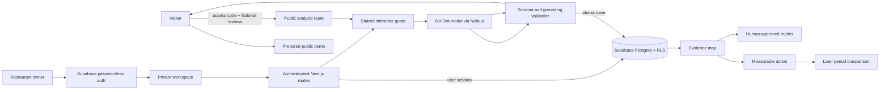

# Architecture

Lyoria ReviewOps has two paths. The public path is a fictional, read-only jury demo with an optional protected live inference. The private path is restricted to the existing owner account, delivers passwordless sign-in emails through Resend and persists one restaurant's review history in Supabase.

## Data flow

1. The browser validates basic form shape and sends at most 15 reviews to a same-origin route.
2. Public live analysis requires a reviewer access code. Private operations require a verified Supabase session.
3. The server sends only the submitted business facts and review text to Nebius. Provider credentials stay on the server.
4. Model output is accepted only when it is complete JSON, contains one reply per review, and every review or business-fact quote exists exactly in the submitted source.
5. The public result stays in the browser. Private results are written atomically to a running analysis record; failed validation stores a failure state without partial themes or replies.
6. Supabase row-level security scopes every private table to the restaurant owner. Later comparisons use dated imports and report association rather than causation.

## Main components

| Area | Responsibility |
| --- | --- |
| `components/review-demo.tsx` | Public prepared example, optional live analysis and local approval flow |
| `app/api/demo/analyze` | Access code, request size, concurrency and quota checks for public inference |
| `app/workspace` | Authenticated imports, saved analyses, actions, replies and comparisons |
| `lib/ai` | Prompt, input/output validation, provider adapter and deterministic priority score |
| `lib/impact` | Deterministic theme matching and before/after classification |
| `supabase/migrations` | Reproducible schema, constraints, RLS policies and transactional functions |

Graphify generated the code relationship graph used to verify these paths. Its local output is intentionally ignored by Git because it is reproducible.
